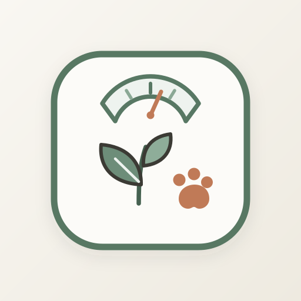

# 家與毛孩體重誌 · Kin & Paws Weight

  

一款採用**文青、樸素、清新**設計語彙的家庭與毛孩體重紀錄 APP，支援 **家人、貓咪與狗狗** 共用家庭同步碼追蹤日常體重變化、健康指標與個人隱私保護。

## 主要特色
- **全家與毛孩皆適用**：支援家人（衛福部 BMI 與健康體重區間）、貓咪與狗狗（獸醫標準 RER / DER 每日熱量建議）。
- **12 款原創文青插畫頭像**：人物、貓咪、狗狗與生活風格頭像皆可自由挑選與跨裝置同步。
- **統計分析與長按點位檢視**：支援日／週／月／年趨勢圖、歷史階梯式目標體重線、區間摘要、目標進度條、歷史紀錄自動分頁，以及長按左右拖曳檢視單點體重。
- **體重隱私遮罩＋選配個人 4 位數 PIN 鎖**：針對個別成員隱藏真實公斤數、精確 BMI 與圖表刻度，僅呈現變化趨勢與達標進度，驗證 PIN 後暫時檢視並於 5 分鐘或離開畫面時自動重新隱藏。
- **批量紀錄與樂觀同步**：一鍵批量填寫全家今日體重，採樂觀更新＋背景 FIFO 序列佇列同步，無阻斷式遮罩。

## 專案目錄
- `frontend/`：Capacitor + Tailwind CSS + 原生 ES Module 前端（嚴格 CSP、零外部 CDN）。
  - `frontend/www/icons/`：網頁 Favicon、Apple Touch Icon 與 PWA 圖示（SVG / 192px / 512px）。
  - `frontend/resources/`：Capacitor 原生 App 圖示母檔（`icon-only.png`、`icon-foreground.png`、`icon-background.png`，可透過 `npx @capacitor/assets generate` 一鍵產生 Android / iOS 圖示）。
- `backend/`：Express + Supabase + Zod v4 嚴格驗證後端 API。
  - `backend/sql/`：Supabase 資料庫建表與遷移腳本（全新建置請先執行 `000_init_schema.sql` 與 `001_target_weight_history.sql`；舊庫升級請依序執行 `001` → `002` → `003` → `004` → `005`）。
- [CHANGELOG.md](./CHANGELOG.md)：完整版本號與更新紀錄表。